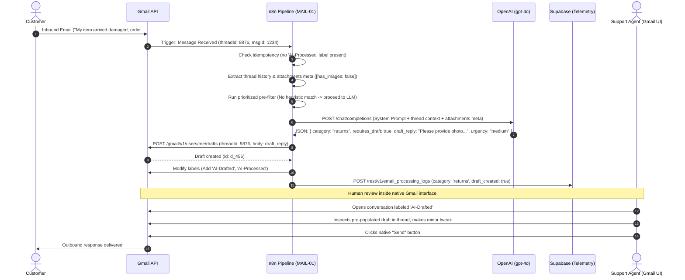
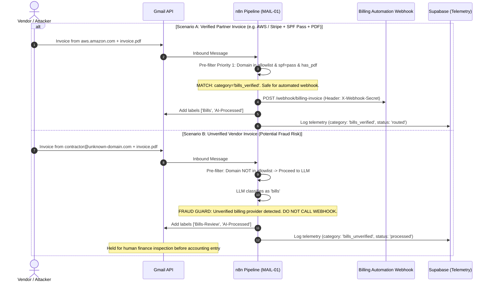

# Automation Architecture — Streamlined E-mail Triage & Native In-Thread Drafting

**Document Version:** 2.1.0  
**Status:** Approved Production Architecture  
**Author:** Principal Automation Architect and Systems Engineer  

---

## Executive Summary

The **Streamlined E-mail Triage & Native In-Thread Drafting System** provides automated inbox classification, safe downstream routing, and context-grounded response drafting for Google Workspace / Gmail company mailboxes.

### 1. Architectural Scope & Review Resolution
Based on architectural review, this specification resolves key security, logic, and operational gaps from prior revisions:
* **Single Master Document**: Standardized on this single `architecture.md` file (the legacy multi-workflow design is archived in [`architecture_legacy_v1.md`](./architecture_legacy_v1.md) for audit comparison).
* **Prioritized Non-Destructive Pre-Filtering**: Known billing providers are verified first before bulk checks. Legitimate emails carrying `List-Unsubscribe` or SPF forwarding anomalies are labeled (`AI-Newsletter`, `Auth-Warning`) rather than silently archived.
* **Invoice-Fraud Protection**: Only authenticated known vendors (`bills_verified`) dispatch to the Billing webhook. Unverified vendor invoices flagged by the LLM are labeled `Bills-Review` and require human verification before accounting ingestion.
* **Dual-Label Queue Clarity**: Replaced the ambiguous `Needs-Review` tag with two explicit states:
  * `AI-Drafted`: Pre-populated draft created in thread; operator reviews and clicks Send.
  * `Needs-Manual-Reply`: Inquiry cannot be safely answered from policy; operator must write response.
* **Truthful Security & Scope Boundary**: Acknowledges that `gmail.modify` / `gmail.compose` scopes technically include API-level send capabilities. Enforces human review at the workflow boundary (`drafts.create` only) backed by n8n RBAC and Workspace-Internal OAuth apps.
* **Idempotency & Thread History**: Prevents duplicate drafts using the `AI-Processed` label and thread draft checks, while passing thread turn history and attachment metadata to the LLM.

---

## 1. Architectural Principles

1. **Native In-Thread Drafts & Operator Dispatch**: Inquiries covered by company policy receive a pre-populated draft inserted directly into the original conversation thread in Gmail. Review and dispatch occur exclusively inside the native Gmail interface (web or mobile).
2. **Prioritized Pre-Filtering First**: Code-level checks evaluate known billing domains, authentication headers, and bulk headers in strict priority order before LLM invocation, saving token costs and reducing execution latency for routine mail.
3. **Non-Destructive by Default**: No incoming email is silently deleted or archived. Flagged newsletters and authentication warnings remain accessible in labeled queues for periodic review.
4. **Strict Fraud Boundary on Financial Webhooks**: Automated dispatch to accounting pipelines is restricted strictly to authenticated, allowlisted vendors (`spf=pass` or `dkim=pass` with PDF attachment). Unverified billing mail is held for human approval.
5. **In-Context Policy Grounding**: Company FAQs, return policies, and brand voice guidelines are maintained in a versioned prompt file ([`prompts/triage_system_prompt.md`](./prompts/triage_system_prompt.md)) and passed directly to the LLM context window.
6. **Realistic Privacy & Execution Pruning**: Eliminates overstated "GDPR eliminated" claims. Enforces 7-day n8n execution data pruning and 90-day telemetry retention in Supabase.

---

## 2. High-Level System Architecture

```mermaid
flowchart TD
    subgraph Mailbox["Google Workspace / Gmail"]
        Inbox["Gmail Inbox"]
        Thread["Conversation Thread"]
        Labels["Gmail Labels: AI-Drafted, Needs-Manual-Reply, Bills, Bills-Review, Sales, AI-Newsletter, Auth-Warning, AI-Processed"]
        HumanAgent["Human Operator (Gmail Desktop & Mobile)"]
    end

    subgraph N8N["n8n Automation Runtime"]
        subgraph Pipeline["MAIL-01 Unified Email Triage Pipeline"]
            Trigger["Gmail Message Trigger (Unread/INBOX)"]
            IdempCheck{"Idempotency Check\n(Has AI-Processed or existing draft?)"}
            Extract["Extract Thread History & Attachments Meta"]
            PreFilter{"Prioritized Pre-Filter\n1. Known Billing Provider\n2. Auth Failure (SPF/DKIM)\n3. Marketing / Newsletter"}
            LLMStep["Single-Pass LLM Triage & Draft Generator\n(OpenAI gpt-4o Structured JSON)"]
            Router{"Category & Fraud Router (Switch)"}
            
            %% Routes
            RouteBillsVer["bills_verified (Known Partner + Auth Pass)"]
            RouteBillsUnver["bills_unverified (Unverified Vendor)"]
            RouteSales["sales (Lead)"]
            RouteNewsletter["newsletter (Bulk)"]
            RouteAuthWarn["auth_warning (SPF/DKIM fail)"]
            RouteSupport["questions / returns"]
            RouteFallback["fallback / other"]
            
            %% Support Draft Check
            DraftCheck{"Requires Draft?\n(requires_draft == true)"}
        end
        
        ErrorHandler["MAIL-ERR Global Error Handler"]
    end

    subgraph Downstream["Downstream Integrations"]
        BillingAuto["Billing Automation (POST /webhook/billing-invoice)"]
        CRM["CRM / Sales Intake (POST /webhook/sales-lead)"]
        Alert["Resend Admin Alert (On Failure)"]
    end

    subgraph Observability["Supabase PostgreSQL"]
        Logs[("email_processing_logs\n(Audit Telemetry, Cost, Latency)")]
    end

    %% Ingestion & Idempotency
    Inbox -->|New Message Event| Trigger
    Trigger --> IdempCheck
    IdempCheck -->|Already Processed| Stop["Stop (Ignore)"]
    IdempCheck -->|New Unprocessed| Extract
    Extract --> PreFilter

    %% Pre-Filter Branching
    PreFilter -->|Rule Match (Skip LLM)| Router
    PreFilter -->|Requires Evaluation| LLMStep
    LLMStep --> Router

    %% Routing Actions
    Router -->|bills_verified| RouteBillsVer
    RouteBillsVer -->|Authenticated Webhook| BillingAuto
    RouteBillsVer -->|Label: Bills + AI-Processed| Labels
    RouteBillsVer --> Logs

    Router -->|bills_unverified| RouteBillsUnver
    RouteBillsUnver -->|Label: Bills-Review + AI-Processed\n(NO WEBHOOK CALL)| Labels
    RouteBillsUnver --> Logs

    Router -->|sales| RouteSales
    RouteSales -->|Authenticated Webhook| CRM
    RouteSales -->|Label: Sales + AI-Processed| Labels
    RouteSales --> Logs

    Router -->|newsletter| RouteNewsletter
    RouteNewsletter -->|Label: AI-Newsletter + AI-Processed| Labels
    RouteNewsletter --> Logs

    Router -->|auth_warning| RouteAuthWarn
    RouteAuthWarn -->|Label: Auth-Warning + AI-Processed| Labels
    RouteAuthWarn --> Logs

    Router -->|questions / returns| RouteSupport
    RouteSupport --> DraftCheck
    DraftCheck -->|True| ActionDraft["Gmail API: Create In-Thread Draft\nLabel: AI-Drafted + AI-Processed"]
    DraftCheck -->|False| ActionManual["Gmail API: Label: Needs-Manual-Reply + AI-Processed"]
    ActionDraft --> Thread
    ActionDraft --> Logs
    ActionManual --> Labels
    ActionManual --> Logs

    Router -->|fallback| RouteFallback
    RouteFallback --> ActionManual

    %% Human Review Loop
    Thread -.->|Operator reviews in-thread draft| HumanAgent
    Labels -.->|Operator checks Needs-Manual-Reply queue| HumanAgent
    HumanAgent -.->|Manual edit & Click 'Send'| Inbox

    %% Error Handling
    Pipeline -.->|On Exception| ErrorHandler
    ErrorHandler --> Alert
    ErrorHandler --> Logs
```

---

## 3. Core Data Flows & Sequence Diagrams

### 3.1. Standard Customer Support Inquiry (Dual-Label Drafting Path)


### 3.2. Prioritized Pre-Filter & Invoice Fraud Guard


---

## 4. Prioritized Pre-Filtering Specification

Pre-filter checks are executed in code in strict priority order:

| Priority | Rule Name | Detection Criteria | Assigned Category | Automated Action | LLM Invoked? |
| :---: | :--- | :--- | :--- | :--- | :---: |
| **1** | **Verified Billing Partner** | Sender domain in allowlist (`aws.amazon.com`, `stripe.com`, `slack.com`, `cloudflare.com`, etc.) AND (`spf=pass` OR `dkim=pass`) AND has PDF attachment | `bills_verified` | Dispatches to Billing Webhook (`POST /webhook/billing-invoice` with `X-Webhook-Secret`), applies `Bills` and `AI-Processed` labels | **No** (Tokens saved) |
| **2** | **Authentication Failure Warning** | `Authentication-Results` contains `spf=fail` OR `dkim=fail` | `auth_warning` | Applies `Auth-Warning` and `AI-Processed` labels. **Kept in inbox for inspection (NOT auto-archived)** | **No** (Tokens saved) |
| **3** | **Marketing Newsletter** | `List-Unsubscribe` present AND (`Precedence: bulk` OR `Precedence: list`) | `newsletter` | Applies `AI-Newsletter` and `AI-Processed` labels. **Kept in labeled queue (NOT auto-archived)** | **No** (Tokens saved) |
| **4** | **General Inquiries** | Fails all above heuristic rules | `pending_llm` | Ingests thread context and attachments metadata for single-pass structured LLM analysis | **Yes** |

---

## 5. Security, Permissions & Compliance Architecture

### 5.1. Google OAuth Permissions & Boundaries
* **Scope Realities**: Standard Google OAuth scopes (`https://www.googleapis.com/auth/gmail.modify` and `gmail.compose`) grant API-level permissions to create drafts as well as send messages.
* **Workflow Boundary**: The pipeline strictly invokes `drafts.create` and contains zero `messages.send` nodes.
* **Access Hardening**: Editing access to the n8n instance and workflow definition must be restricted using role-based access control (RBAC).
* **Workspace-Internal OAuth**: The OAuth consent screen must be configured as **Internal** within Google Workspace. External applications in "Testing" status suffer from 7-day refresh token revocations.

### 5.2. Webhook Authentication
All downstream integration endpoints (`Billing Webhook`, `CRM Webhook`) require authentication via a shared secret header (`X-Webhook-Secret`). Unauthenticated calls are rejected with `401 Unauthorized`.

### 5.3. Privacy, Data Retention & GDPR
* **n8n Execution Pruning**: n8n must be configured with execution data pruning enabled:
  ```env
  EXECUTIONS_DATA_PRUNE=true
  EXECUTIONS_DATA_MAX_AGE=168 # 7 days
  ```
* **Telemetry Anonymization**: The Supabase telemetry table stores operational metrics (category, latency, token count, execution time). Sensitive sender emails and subjects expire and are deleted after 90 days via `purge_expired_email_logs()`.

---

## 6. Minimal Database Schema (Supabase)

```sql
-- ========================================================================
-- Streamlined Email Processing Telemetry & Audit Schema
-- ========================================================================

CREATE TABLE IF NOT EXISTS email_processing_logs (
  id UUID PRIMARY KEY DEFAULT gen_random_uuid(),
  message_id TEXT UNIQUE NOT NULL, -- Enforces idempotency
  thread_id TEXT,
  sender_email TEXT,
  subject TEXT,
  category TEXT NOT NULL CHECK (category IN (
    'sales', 'bills_verified', 'bills_unverified', 'returns', 'questions',
    'newsletter', 'auth_warning', 'other', 'error'
  )),
  confidence NUMERIC(4, 3) DEFAULT 1.0,
  pre_filtered BOOLEAN DEFAULT false,
  draft_created BOOLEAN DEFAULT false,
  execution_time_ms INTEGER DEFAULT 0,
  prompt_tokens INTEGER DEFAULT 0,
  completion_tokens INTEGER DEFAULT 0,
  status TEXT DEFAULT 'processed' CHECK (status IN ('processed', 'routed', 'draft_created', 'failed')),
  error_message TEXT,
  created_at TIMESTAMPTZ DEFAULT now()
);

-- Operational indexes for latency and cost tracking
CREATE INDEX IF NOT EXISTS idx_email_logs_message_id ON email_processing_logs(message_id);
CREATE INDEX IF NOT EXISTS idx_email_logs_category ON email_processing_logs(category);
CREATE INDEX IF NOT EXISTS idx_email_logs_created_at ON email_processing_logs(created_at DESC);

-- Automated 90-day telemetry retention cleanup
CREATE OR REPLACE FUNCTION purge_expired_email_logs()
RETURNS void LANGUAGE plpgsql SECURITY DEFINER AS $$
BEGIN
  DELETE FROM email_processing_logs WHERE created_at < now() - INTERVAL '90 days';
END;
$$;
```

---

## 7. Repository Layout & File Map

```text
email-sorting-automation/
├── architecture.md                     # Approved System Specification v2.1.0 (this document)
├── architecture_legacy_v1.md           # Preserved pre-simplification architecture for comparison
├── README.md                           # Operator Setup Guide & Label Taxonomy
├── comparison.md                       # Technical & TCO comparison vs. commercial SaaS
├── prompts/
│   └── triage_system_prompt.md         # Dedicated versioned prompt with policies & JSON schema
├── n8n-workflows/
│   ├── mail-01-email-triage-pipeline.json # Unified linear triage, pre-filter, drafting & routing pipeline
│   └── mail-err-error-handler.json       # Centralized runtime exception trap & Resend notifier
└── sql/
    └── schema.sql                      # Single-table Supabase telemetry schema & retention cleanup
```
