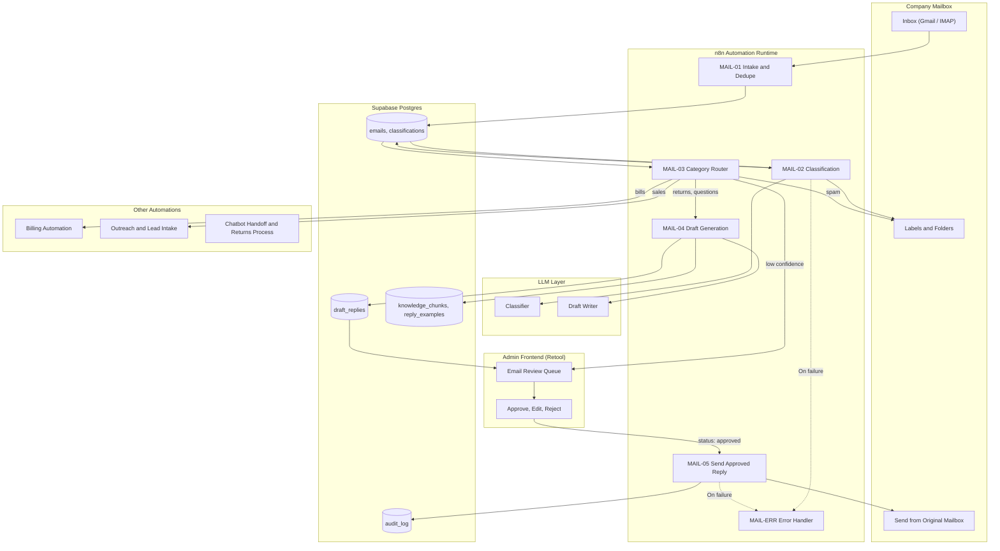
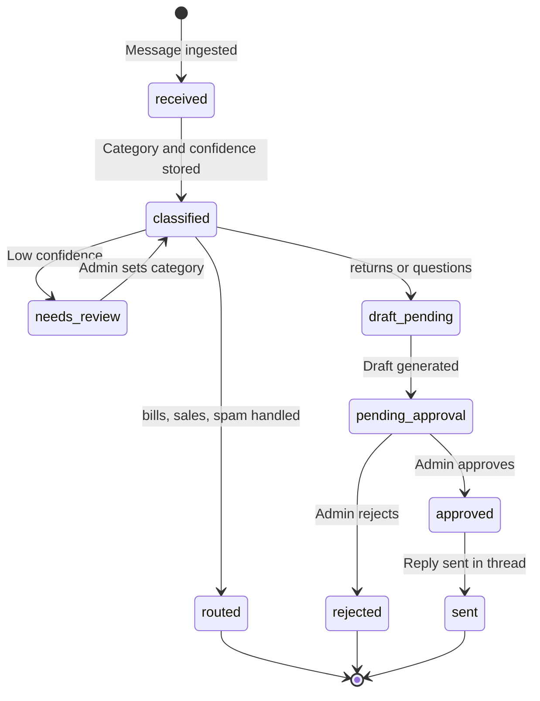
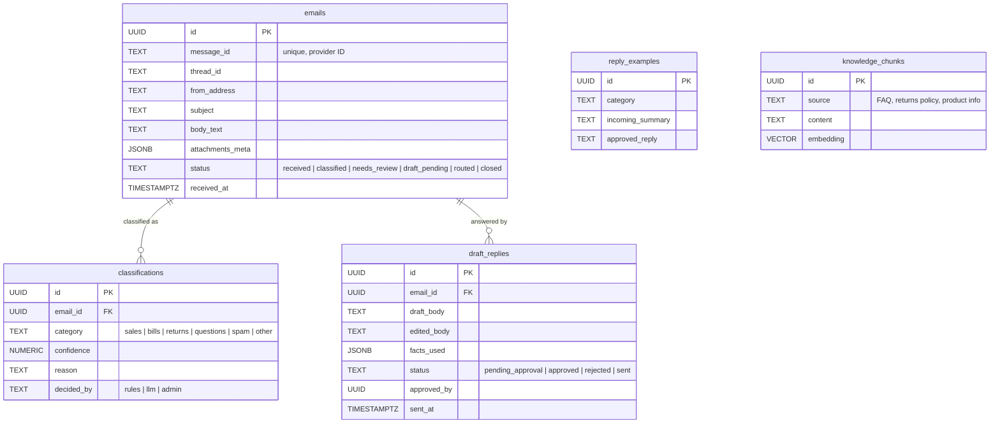

# Automation Architecture — E-mail Sorting & Draft Reply System (Legacy v1.0.0)

> [!NOTE]
> This is the legacy, pre-simplification architecture preserved for technical comparison and audit purposes.
> See `architecture.md` for the current, approved production architecture.

The **E-mail Sorting System** is an inbox automation built on **n8n**, **Supabase (Postgres)**, an **LLM API**, and the company mailbox (**Gmail / IMAP**).

It categorizes every incoming email by function (**sales, bills, returns, questions, spam**), routes each category to the right downstream action, and proposes draft answers for selected categories. **No reply is ever sent without explicit admin authorization** in the database-backed frontend.

---

## 1. Architectural Principles

1. **Never Send Without Authorization**: Drafts are proposals. The send step only runs on a row the admin has approved. Auto-send is out of scope by design.
2. **Classify, Then Act**: Classification is a separate, auditable step with a confidence score. Actions depend on category *and* confidence; low confidence falls back to a safe `needs_review` lane.
3. **Emails Are Untrusted Input**: Email content is data, never instructions. It is delimited in prompts, and the LLM has no tools that can send, delete, or forward mail on its own.
4. **Non-Destructive by Default**: The system applies labels, creates drafts, and logs. Spam is labeled and moved to a quarantine folder, not permanently deleted.
5. **Idempotency**: Each message is processed once, keyed by the provider message ID. Re-delivery or workflow restarts never produce duplicate drafts.
6. **Feedback Loop**: Admin corrections (re-categorized emails, edited drafts) are stored and used to improve prompts and example sets.

---

## 2. High-Level System Architecture



---

## 3. Core Data Flows & Sequence Diagrams

### 3.1. Classification & Routing
```mermaid
sequenceDiagram
    autonumber
    participant Box as Mailbox
    participant M1 as MAIL-01 Intake
    participant DB as Supabase
    participant M2 as MAIL-02 Classifier
    participant LLM as LLM
    participant M3 as MAIL-03 Router
    participant Down as Downstream Automation

    Box->>M1: New message (trigger or polling)
    M1->>DB: Check message_id exists
    alt Already processed
        M1->>M1: Stop
    else New
        M1->>DB: INSERT email { from, subject, body_text, attachments_meta, status: received }
    end

    DB->>M2: Trigger: status = received
    M2->>M2: Strip HTML, trim quoted history, extract sender and domain
    M2->>M2: Pre-filter rules (known sender lists, SPF/DKIM fail, list-unsubscribe headers)
    M2->>LLM: Classify into sales | bills | returns | questions | spam | other
    LLM-->>M2: { category, confidence, reason, language, urgency }
    M2->>DB: INSERT classification, status = classified
    M2->>Box: Apply category label

    DB->>M3: Trigger: status = classified
    alt confidence below threshold
        M3->>DB: status = needs_review
    else category = bills
        M3->>Down: Send attachments to Billing Automation
    else category = sales
        M3->>Down: Create lead record, notify owner
    else category = spam
        M3->>Box: Move to quarantine label
    else category = returns or questions
        M3->>DB: status = draft_pending
    end
```

### 3.2. Draft Reply & Admin Authorization (Retool Dashboard)
```mermaid
sequenceDiagram
    autonumber
    participant DB as Supabase
    participant M4 as MAIL-04 Draft Generation
    participant LLM as LLM
    participant UI as Admin Frontend (Retool)
    actor Admin as Admin
    participant M5 as MAIL-05 Send
    participant Box as Mailbox

    DB->>M4: Trigger: status = draft_pending
    M4->>DB: Retrieve knowledge chunks, policies, similar past approved replies
    M4->>LLM: Draft reply in company voice using only retrieved facts
    LLM-->>M4: { draft, facts_used, confidence, needs_info }
    M4->>M4: Validate (no invented prices or promises, correct language, signature, tone)
    M4->>DB: INSERT draft_reply { status: pending_approval }
    DB-->>UI: Appears in review queue with original email and draft

    Admin->>UI: Review original + draft
    alt Approve as is
        UI->>DB: status = approved
    else Edit and approve
        UI->>DB: Save edited_body, status = approved, store edit for feedback
    else Reject or write manually
        UI->>DB: status = rejected
    end

    DB->>M5: Trigger: status = approved
    M5->>M5: Re-check not already sent
    M5->>Box: Send as reply in original thread (From original mailbox)
    M5->>DB: status = sent, sent_at, audit entry
```

### 3.3. Email Lifecycle State Machine


---

## 4. Workflow Catalog (Legacy n8n)

| ID | Workflow | Trigger | Key Actions | Writes |
| :--- | :--- | :--- | :--- | :--- |
| **MAIL-01** | Intake & Dedupe | Gmail trigger / IMAP poll | Dedupe by message ID, store normalized email | `emails`, `status: received` |
| **MAIL-02** | Classification | `status = received` | Pre-filters, LLM classification, apply label | `classifications`, `status: classified` |
| **MAIL-03** | Category Router | `status = classified` | Route by category and confidence | `status`, downstream calls |
| **MAIL-04** | Draft Generation | `status = draft_pending` | Retrieve context, draft, validate | `draft_replies` |
| **MAIL-05** | Send Approved Reply | `draft_replies.status = approved` | Send in thread, log | `status: sent`, `audit_log` |
| **MAIL-06** | Feedback Aggregator | Weekly schedule | Summarize re-categorizations and edits | `reply_examples` |
| **MAIL-ERR** | Error Handler | n8n Error Trigger | Alert admin, keep email in `needs_review` | `workflow_log` |

---

## 5. Database Architecture (Legacy Supabase)


